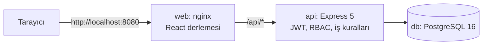
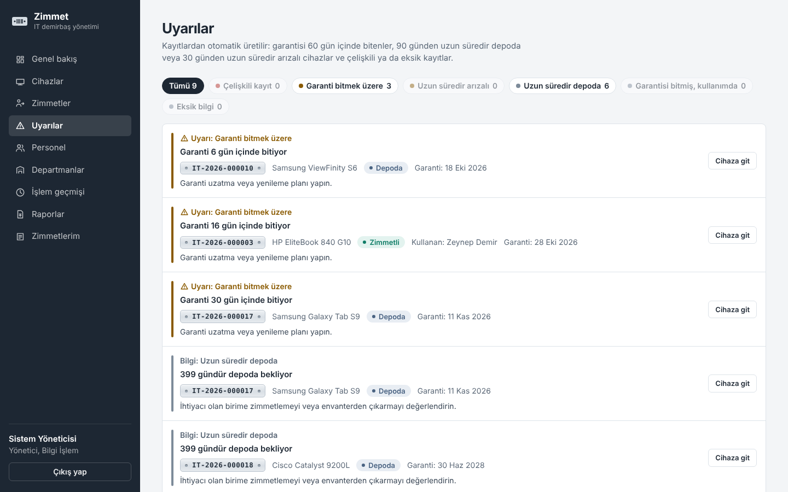
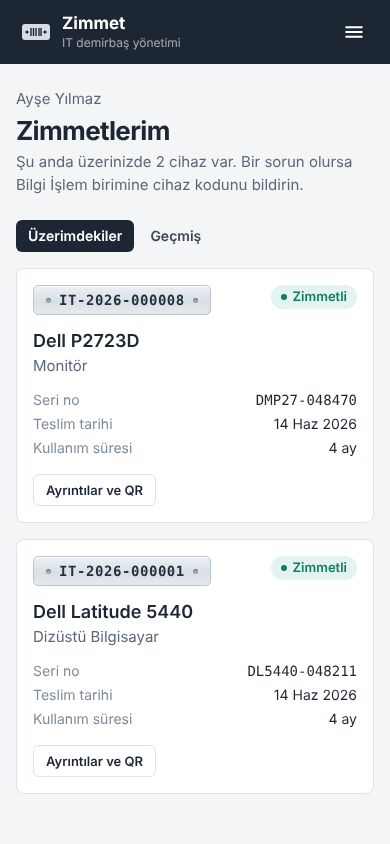

# IT Demirbaş ve Zimmet Yönetim Sistemi

Kurumdaki bilişim donanımlarının (bilgisayar, monitör, sunucu vb.) envanterini tutan; cihazların kimde olduğunu, personele teslim ve iade süreçlerini, arıza kayıtlarını ve tüm işlem geçmişini yöneten full-stack web uygulaması.

*Yapay Zekâ ve Dijital Dönüşüm Koordinatörlüğü — Aday Mühendis Değerlendirme Projesi.* Gereksinimler: [PRD.md](./PRD.md) · Görev listesi ve aşama notları: [task.md](./task.md)


## Özellikler

**Zorunlu kapsam (PRD §4.1)**
- JWT ile giriş/çıkış; parolalar bcrypt ile özetlenir; token httpOnly cookie'de tutulur. Geçici parola ilk girişte değiştirilir; herkes kendi parolasını değiştirebilir.
- Rol tabanlı yetki (Yönetici / Personel): her kontrol backend middleware'inde yapılır, arayüz yalnızca görünürlüğü yönetir.
- Kullanıcı yönetimi: ekle, düzenle, pasife al, sil (geçmişi yoksa), parola sıfırla, departmanlar.
- Envanter: cihaz ekle/düzenle/pasife al/sil, otomatik benzersiz kod (`IT-2026-000042`) ve QR kod (PNG/SVG, etiket yazdırma).
- Zimmet: teslim ve iade. Aynı cihaz aynı anda iki kişiye zimmetlenemez; bu kural üç katmanda korunur (servis kontrolü, satır kilidi, veritabanı partial unique index). İade edilen cihaz depoya döner ve yeniden zimmetlenebilir.
- Dashboard: toplam / zimmetli / depoda / arızalı cihaz sayıları. Her açılışta veritabanından canlı hesaplanır.
- Tüm listelerde arama, filtre (durum, kategori, departman, kullanıcı), sıralama ve sayfalama.
- Responsive arayüz (mobilde tablolar karta dönüşür), anlık bildirimler (toast).
- Personel yalnızca kendi zimmetlerini ve kendi üzerindeki cihazın detayını/QR'ını görür.

**Farklılaştırıcı kapsam (PRD §4.2)**
- Akıllı kontrol merkezi: garantisi yaklaşan, uzun süredir depoda/arızalı cihazlar ve çelişkili/eksik kayıtlar için uyarılar. Hepsi veritabanından anlık üretilir.
- Cihaz zaman çizelgesi: ekleme, düzenleme, durum değişikliği, zimmet, iade ve bakım olayları, kimin yaptığı ve tarihiyle birlikte. İşlem geçmişi değiştirilemez; veritabanı trigger'ı UPDATE ve DELETE'i reddeder.
- Arıza ve bakım: kayıt açma, işleme alma, çözüm notuyla kapatma; cihaz başına çoklu kayıt.
- Raporlar: envanter ve zimmet raporları, filtreli CSV (Excel'de doğrudan açılır); tarayıcıdan yazdır / PDF.

## Teknolojiler

| Katman | Seçim |
|--------|-------|
| Frontend | React 19, Vite 6, Tailwind CSS 4 (harici UI/router kütüphanesi yok) |
| Backend | Node.js 22, Express 5, zod (doğrulama), helmet, express-rate-limit, qrcode |
| Veritabanı | PostgreSQL 16 (pg_trgm ile arama indeksi) |
| Kimlik | JWT (HS256) + bcrypt |
| Dağıtım | Docker Compose: `db` (postgres) + `api` (Node) + `web` (nginx: arayüz + `/api` ters vekil) |



## Kurulum (Docker)

Gereken tek şey [Docker Desktop](https://www.docker.com/products/docker-desktop/) (veya Docker Engine + Compose v2).

Uygulama **boş bir veritabanıyla** başlar: örnek personel, cihaz, departman veya zimmet yüklenmez, varsayılan bir yönetici hesabı/parolası da yoktur.

**1. Ortam dosyasını hazırlayın** (zorunlu; eksikse compose başlamaz):

```bash
cp .env.example .env
# Rastgele değerler üretip .env içine yazın:
node -e "console.log('POSTGRES_PASSWORD=' + require('crypto').randomBytes(24).toString('hex'))"
node -e "console.log('JWT_SECRET=' + require('crypto').randomBytes(48).toString('hex'))"
```

**2. Başlatın:**

```bash
docker compose up --build -d
```

İlk açılışta API veritabanı tablolarını oluşturur (migration'lar her açılışta güvenle tekrar çalışır, mevcut veriye dokunmaz).

**3. İlk yönetici hesabınızı tarayıcıdan oluşturun.** **http://localhost:8080** adresini açın. Henüz yönetici olmadığı için giriş ekranı yerine **İlk kurulum** ekranı çıkar. Sizden ad soyad, e-posta, parola ve tek kullanımlık bir **kurulum kodu** ister. Kod yalnızca sunucu kayıtlarında yazar; böylece siteye ilk ulaşan başka biri kendini yönetici yapamaz:

```bash
docker compose logs api        # "Kurulum kodu:  XXXX-XXXX-XXXX" satırı
```

(Docker Desktop kullanıyorsanız *api* kapsayıcısının **Logs** sekmesinde de görünür.) Yönetici parolası en az 12 karakter olmalı, harf ve rakam içermeli. Kurulum tamamlanınca bu ekran bir daha çıkmaz; sonraki girişler **Yönetici girişi** sekmesinden yapılır.

> Alternatifler: terminalden `docker compose exec api npm run create-admin -- --email ad.soyad@kurum.gov.tr --name "Ad Soyad"` (parola ekranda gösterilmeden sorulur) veya otomasyon için `.env` içinde `INITIAL_ADMIN_EMAIL` / `INITIAL_ADMIN_PASSWORD` (yalnızca hiç aktif yönetici yokken bir kez kullanılır; sonra parolayı `.env`'den silin).

### Günlük kullanım

- **Giriş ekranı** iki sekmelidir: **Personel girişi** ve **Yönetici girişi**. Yanlış sekmeden giren kişiye doğru sekme söylenir.
- **Kendi kendine kayıt:** Personel girişindeki **Kaydolun** bağlantısıyla yalnızca kurum e-postası (`REGISTRATION_EMAIL_DOMAINS`, varsayılan `gop.edu.tr`) ile kayıt olunur. Hesap, yönetici **Personel** sayfasındaki "Onay bekleyen kayıtlar" bölümünden onaylayana kadar giriş yapamaz (Genel bakış'ta da uyarı çıkar). Kaydı kapatmak için `.env` içine `REGISTRATION_EMAIL_DOMAINS=` (boş) yazın.
- **Kurtarma kodu (e-posta gerekmez):** Kayıt olan (ve ilk kurulumda yönetici olan) herkese bir kez **kurtarma kodu** gösterilir; indirilebilir. Yöneticinin eklediği kişiler kodu ilk parola değişikliğinde alır. Kod istenirse menüdeki **Kurtarma kodu** ile mevcut parolayla yenilenir (eskisi geçersiz olur).
- **Şifremi unuttum:** Giriş ekranındaki bağlantıdan e-posta + kurtarma kodu + yeni parola yazılır; parolayı kişi kendisi yeniler, yönetici dahil herkes için aynıdır. Kod tek kullanımlıktır, kullanılınca yenisi verilir. Kodunu kaybeden kişi **Kurtarma kodum yok** ile yöneticiden yardım ister; talep Personel sayfasına düşer ve yönetici geçici parola verir.
- **Parola değiştirme:** Herkes sol menünün altındaki **Parolamı değiştir** ile parolasını değiştirir.

**Yöneticinin eklediği personel:** Yöneticinin "Personel" ekranında verdiği parola **geçicidir**; kişi ilk girişte kendi parolasını belirlemeden hiçbir sayfaya geçemez. Herkes menüdeki **Parolamı değiştir** ile parolasını değiştirebilir.

**Parolasını unutan / kilitlenen yönetici** (veri silinmez, yalnızca o hesabın parolası değişir ve oturumları kapanır):

```bash
docker compose exec api npm run create-admin -- --email ad.soyad@kurum.gov.tr --reset
# API konteyneri başlamıyorsa:
docker compose run --rm api npm run create-admin -- --email ad.soyad@kurum.gov.tr --reset
```

Durdurmak: `docker compose down` (veriler `db-data` biriminde kalır). `docker compose down -v` **veritabanını kalıcı olarak siler**; yalnızca bilerek kullanın.

**Yedekleme:** `docker compose exec db pg_dump -U zimmet zimmet > yedek-$(date +%F).sql` (yedek dosyalarını repoya eklemeyin; `.gitignore` `*.dump`, `backups/` kalıplarını dışlar).

### Mevcut kurulumu güncelleme (eski sürümden)

Eski sürüm `.env` olmadan `Admin12345` yönetici parolası, `zimmet-local-dev` veritabanı parolası ve (boş veritabanında) örnek veriyle başlıyordu. Bu sürüme geçerken **veriniz silinmez**:

1. **Veritabanı parolası:** PostgreSQL parolayı yalnızca ilk kurulumda okur. Önce mevcut veritabanında değiştirin, sonra aynı değeri `.env`'e yazın:
   ```bash
   docker compose exec db psql -U zimmet -d zimmet -c "ALTER USER zimmet PASSWORD 'YENI_GUCLU_PAROLA'"
   ```
2. `.env` içine `POSTGRES_PASSWORD` (yeni değer) ve `JWT_SECRET` ekleyin; `SEED_ADMIN_*` ve `SEED_DEMO_DATA` satırlarını silin (artık kullanılmaz).
3. `docker compose up --build -d`. Açılışta:
   - Bilinen varsayılan parolayı (`Admin12345` vb.) kullanan aktif bir yönetici varsa API **güvenlik nedeniyle başlamaz** ve logda şu komutu önerir: `docker compose run --rm api npm run create-admin -- --email admin@kurum.local --reset`
   - Eski örnek veriden kalan demo personel hesaplarının (`…@kurum.local`, parola `Personel123`) parolası geçersiz kılınır. Hesaplar, cihazlar ve geçmiş **silinmez**; gerekmiyorsa arayüzden pasife alabilirsiniz (işlem geçmişi korunduğu için kalıcı silme yerine pasife alma önerilir).

## Ortam değişkenleri

| Değişken | Varsayılan | Açıklama |
|----------|-----------|----------|
| `POSTGRES_PASSWORD` | **zorunlu** | Veritabanı parolası. Üretimde boş veya bilinen bir değer (`zimmet-local-dev` vb.) ise API başlamaz. Port dışarı açılmaz. |
| `POSTGRES_DB` / `POSTGRES_USER` | `zimmet` / `zimmet` | Veritabanı adı ve kullanıcısı. |
| `JWT_SECRET` | **zorunlu** | ≥ 32 karakter, rastgele. Üretimde eksik, kısa veya yer tutucuysa API başlamaz. |
| `JWT_EXPIRES_IN` | `8h` | Oturum süresi (`30m`, `8h`, `1d`). |
| `APP_BASE_URL` | `http://localhost:8080` | QR kodların içine yazılan adres; uygulamaya hangi adresten erişiliyorsa o. |
| `COOKIE_SECURE` | `false` | HTTPS arkasında `true` yapın. `APP_BASE_URL` https ise zorunlu. |
| `APP_TIMEZONE` | `Europe/Istanbul` | "Bugün" hesabı, tarih filtreleri, uyarılar ve CSV raporlarındaki saatler (eski adı `REPORT_TIMEZONE` da okunur). |
| `TRUST_PROXY` | yerel/özel ağ | Express "trust proxy". Varsayılan yalnızca yerel/özel ağdaki vekillere (Docker içindeki nginx) güvenir. |
| `INITIAL_ADMIN_EMAIL` / `INITIAL_ADMIN_PASSWORD` / `INITIAL_ADMIN_NAME` | *(boş)* | İsteğe bağlı ilk yönetici; yalnızca hiç aktif yönetici yokken kullanılır. Parola ≥ 12 karakter. |
| `REGISTRATION_EMAIL_DOMAINS` | `gop.edu.tr` (compose) | Kendi kendine kayda izin verilen alan adları (virgülle). Boşsa kayıt kapalı. Kayıtlar yönetici onayı ister. |
| `ALERT_WARRANTY_DAYS` / `ALERT_IDLE_DAYS` / `ALERT_DEFECTIVE_DAYS` | `60` / `90` / `30` | Uyarı eşikleri (gün). |
| `WEB_PORT` | `8080` | Uygulamanın açılacağı port. |

## Docker olmadan geliştirme

Node.js 20+ ve çalışan bir PostgreSQL 16 gerekir (`pg_trgm` eklentisi PostgreSQL ile birlikte gelir).

```bash
# Veritabanı (kök dizinde, .env dolu olmalı)
docker compose -f docker-compose.yml -f docker-compose.dev.yml up -d db

# Backend
cd backend
cp .env.example .env          # DATABASE_URL içindeki <PAROLA>'yı kök .env'deki POSTGRES_PASSWORD ile değiştirin
npm install
npm run setup                 # migration + açılış kontrolleri (örnek veri YÜKLEMEZ)
npm run create-admin -- --email ad.soyad@kurum.gov.tr --name "Ad Soyad"
npm run dev                   # http://localhost:3000

# Frontend (ayrı terminal)
cd frontend
npm install
npm run dev                   # http://localhost:5173 (/api istekleri 3000'e aktarılır)
```

## Güvenlik ve oturum stratejisi

- **Varsayılan hesap yok:** Demo hesapları ve örnek veri kaldırıldı. İlk yönetici `create-admin` komutuyla (veya bir kez `INITIAL_ADMIN_*` ile) oluşturulur; kurulum betiği var olan bir kullanıcıyı sessizce yöneticiye yükseltmez.
- **Üretimde güvensiz başlamaz:** `JWT_SECRET` eksik/kısa/yer tutucu, veritabanı parolası boş/bilinen, https adreste `COOKIE_SECURE=false` veya varsayılan parolalı aktif yönetici varsa API başlamaz ve nedenini loglar.
- **Parolalar:** bcrypt; en az 8 karakter, harf + rakam; bilinen/yaygın parolalar reddedilir. Yöneticinin verdiği parola geçicidir (ilk girişte değiştirilir). Kullanıcı kendi parolasını değiştirince diğer oturumları kapanır.
- **Token saklama:** Web istemcisinde JWT, `httpOnly; SameSite=Strict` cookie'de durur; JavaScript token'a erişemez. Mobil/API istemcileri girişte `issueToken: true` gönderip `Authorization: Bearer` kullanabilir.
- **Oturum iptali:** Her kullanıcının `token_version` değeri var; parola değişikliği/sıfırlama, pasife alma ve rol değişikliği bu değeri artırır, eski token'lar anında geçersiz olur. Rol her istekte veritabanından okunur.
- **Yetki:** Her kontrol backend'de yapılır. Personel yalnızca kendi zimmetlerini ve kendi üzerindeki cihazı görür; başkasının cihazında `404` alır (varlığı sızdırılmaz).
- **CSRF:** SameSite=Strict + yalnızca `application/json` gövde kabulü (aksi `415`).
- **Girdi:** Tüm sorgular parametreli; sıralama alanları beyaz listeli; gövde ve sorgu parametreleri zod ile doğrulanır, şemada olmayan alanlar atılır.
- **Diğer:** Giriş ve parola değiştirmede ayrı hız sınırı, hatalı girişte e-postanın varlığı belli edilmez, yanıtlarda/loglarda/işlem geçmişinde parola veya hash yok.

Ayrıntılar: [docs/SECURITY.md](docs/SECURITY.md) · Yetki haritası: [docs/PERMISSIONS.md](docs/PERMISSIONS.md)

## Testler

Backend'de entegrasyon testleri var (`backend/test/`, `node:test`); testler gerçek bir PostgreSQL veritabanına karşı çalışır. **Test veritabanının adı `_test` ile bitmelidir**, çünkü testler her dosyada bu veritabanını sıfırlar (gerçek veritabanınızı asla vermeyin).

```bash
docker compose -f docker-compose.yml -f docker-compose.dev.yml up -d db
docker compose exec db createdb -U zimmet zimmet_test

cd backend && npm install
TEST_DATABASE_URL=postgres://zimmet:<PAROLA>@localhost:5432/zimmet_test npm test
```

| Kapsam | Test dosyası |
|--------|--------------|
| Giriş, oturum, rate limit, token iptali | `auth.test.js` |
| Temiz kurulum (demo veri yok), ilk yönetici, `create-admin`, eski varsayılan parolalar, üretim ayar kontrolleri | `setup-security.test.js` |
| Geçici parola, kendi parolasını değiştirme | `password-change.test.js` |
| Giriş sekmeleri, şifremi unuttum talepleri, tarayıcıdan ilk kurulum | `login-reset-setup.test.js` |
| Kendi kendine kayıt, yönetici onayı, kurtarma koduyla parola yenileme | `register-recover.test.js` |
| Yetki ihlali engeli, kullanıcı/departman yönetimi | `users.test.js`, `assets.test.js`, `assignments.test.js` |
| Mükerrer kayıt koruması | `assets.test.js` |
| Çakışan zimmet (8 eşzamanlı istekten yalnızca 1'i başarılı), iade, pasif cihaz/personel | `assignments.test.js`, `integrity.test.js` |
| Başarısız işlemin geri alınması (transaction), bakım geçmişinin korunması, saat dilimi ve tarih aralığı kuralları | `integrity.test.js` |
| Dashboard sayılarının veritabanıyla tutarlılığı, uyarılar | `dashboard.test.js` |
| Bakım, CSV raporları, gizli bilgi sızıntısı | `maintenance-reports.test.js` |

Frontend için otomatik test yoktur (bkz. Bilinen notlar).

## Proje yapısı

```
.
├── backend/
│   ├── src/
│   │   ├── migrations/     001–007 SQL (sırayla, bir kez uygulanır)
│   │   ├── routes/         auth, users, departments, assets, assignments, me,
│   │   │                   audit-logs, dashboard, alerts, maintenance, reports
│   │   ├── services/       zimmet iş kuralları, uyarı kuralları, cihaz kodu
│   │   ├── middleware/     authenticate, requireRole, validate, errorHandler
│   │   └── scripts/        migrate.js, seed.js (ilk kurulum/güvenlik kontrolleri), createAdmin.js
│   └── test/               node:test entegrasyon testleri
├── frontend/
│   ├── src/pages/          ekranlar
│   ├── src/components/     Layout, tablo, modal, zimmet pencereleri, zaman çizelgesi…
│   └── nginx.conf          üretimde arayüz + /api ters vekil
├── docs/                   ERD, API, yetki haritası, güvenlik, ekran görüntüleri
└── docker-compose.yml
```

Klasör yapısı: monorepo aracı kullanılmadı. `backend/` ve `frontend/` kendi `package.json` dosyalarıyla bağımsız kurulur ve ayrı Docker imajı olarak derlenir.

## Tasarım dokümanları

- [docs/ERD.md](docs/ERD.md): veri modeli, durum makinesi, kısıtlar, indeksler
- [docs/API.md](docs/API.md): tüm uç noktalar, hata kodları, filtre parametreleri
- [docs/PERMISSIONS.md](docs/PERMISSIONS.md): rol × ekran × API yetki haritası
- [docs/SECURITY.md](docs/SECURITY.md): parola, JWT, girdi ve log güvenliği

## Ekran görüntüleri

| | |
|---|---|
|  |  |
|  |  |
|  |  |

## Bilinen notlar

- Depoda `package-lock.json` bulunmuyor. İlk `npm install` sonrasında oluşan `package-lock.json` dosyalarını commit etmeniz, sürümleri sabitlemek için önerilir. Dockerfile'lar lock dosyası varsa otomatik olarak `npm ci` kullanır.
- Ekran görüntülerindeki kişi ve cihaz adları temsilidir; uygulama bu kayıtları oluşturmaz.
- Frontend için otomatik (birim/uçtan uca) test paketi henüz yok.
- PDF raporu ayrı bir kütüphaneyle değil, rapor sayfasının yazdırma görünümü ve tarayıcının "PDF olarak kaydet" seçeneğiyle alınır.
- Mobil uygulama (PRD §4.3, opsiyonel Faz 3) bu teslimatta yok. API buna hazırdır: Bearer token desteği var ve QR kodu `/assets/code/:kod` adresine çözülür.
