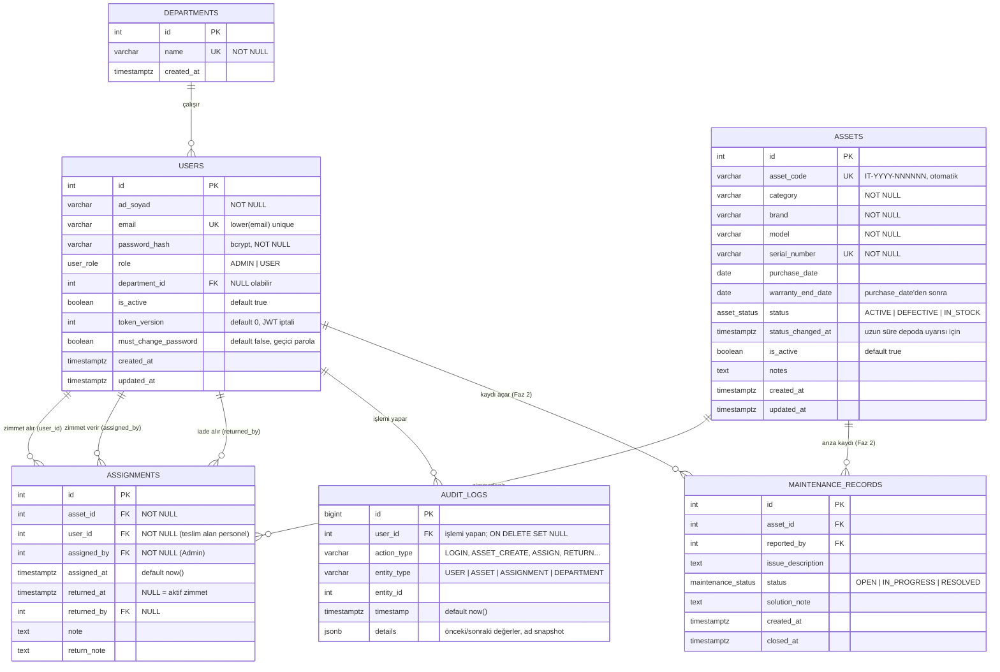

# Veritabanı Tasarımı (ERD) — Aşama 1

Kaynak: PRD §5.2, task.md Aşama 1. Veritabanı: PostgreSQL 16.
Tablo adları `snake_case` ve çoğul; tüm zaman damgaları `TIMESTAMPTZ` (UTC saklanır).

## 1. Varlık-İlişki Diyagramı



> PRD şemasına yapılan küçük eklemeler (gerekçeli):
> - `users.must_change_password` (migration 005): yöneticinin verdiği/sıfırladığı geçici parolada TRUE; kullanıcı kendi parolasını belirleyene kadar yalnızca `/auth/me` ve `/auth/change-password` uçlarını kullanabilir.
> - `users.token_version`: şifre değişince / kullanıcı pasife alınınca eski JWT'leri anında geçersiz kılmak için.
> - `users.updated_at`, `assets.updated_at`, `assets.notes`: düzenleme takibi ve serbest not.
> - `assets.status_changed_at`: Faz 2 "uzun süredir depoda" uyarısının gerçek veriden hesaplanması için.
> - `assignments.returned_by`, `assignments.return_note`: iadeyi kimin aldığını geçmişte kaybetmemek için.

## 2. Enum tipleri

| Tip | Değerler | Anlamı |
|-----|----------|--------|
| `user_role` | `ADMIN`, `USER` | PRD §3 rolleri |
| `asset_status` | `ACTIVE` | Personelde zimmetli / kullanımda |
| | `DEFECTIVE` | Arızalı (zimmetlenemez) |
| | `IN_STOCK` | Boşta / depoda (zimmetlenebilir) |
| `maintenance_status` (Faz 2) | `OPEN`, `IN_PROGRESS`, `RESOLVED` | Arıza kaydı durumu |

## 3. Durum makinesi ve tutarlılık kuralı

**Değişmez (invariant):** `assets.status = 'ACTIVE'` ⇔ cihazın `returned_at IS NULL` olan bir zimmet kaydı var.

```
              assign (Admin)
  IN_STOCK  ──────────────────►  ACTIVE
     ▲  ▲                          │
     │  │   return (varsayılan)    │
     │  └──────────────────────────┤
     │                             │ return (condition=DEFECTIVE)
     │  status değişikliği         ▼
     └──────────────────────────  DEFECTIVE
        (Admin, tamir sonrası)
```

- Zimmet yalnızca `status = IN_STOCK` **ve** `is_active = true` olan cihaza yapılır.
- İade: `returned_at = now()`, cihaz → `IN_STOCK` (PRD §4.1). İade sırasında "arızalı teslim edildi" seçilirse → `DEFECTIVE`.
- `ACTIVE` durumu elle verilemez; sadece zimmet işlemi üretir. Zimmetli cihazın durumu elle değiştirilemez (önce iade).
- Zimmetli cihaz pasife alınamaz / silinemez.
- Pasif (`is_active=false`) kullanıcıya zimmet yapılamaz; üzerinde aktif zimmet olan kullanıcı pasife alınamaz.

## 4. Kısıtlar (constraints)

| Kısıt | Tanım | PRD §7 karşılığı |
|-------|-------|------------------|
| `assets_asset_code_key` | `UNIQUE (asset_code)` | Mükerrer cihaz kodu engeli |
| `assets_serial_number_key` | `UNIQUE (serial_number)` | Mükerrer seri no engeli |
| `ux_assignments_active_asset` | `UNIQUE (asset_id) WHERE returned_at IS NULL` (partial unique index) | Çakışan zimmet engeli — **veritabanı seviyesinde** |
| `ux_users_email_lower` | `UNIQUE (lower(email))` | Aynı e-posta iki kez kayıt olamaz |
| `departments_name_key` | `UNIQUE (name)` | — |
| `chk_assignments_return_after` | `returned_at IS NULL OR returned_at >= assigned_at` | Veri tutarlılığı |
| `chk_assets_warranty` | `warranty_end_date IS NULL OR purchase_date IS NULL OR warranty_end_date >= purchase_date` | Veri tutarlılığı |
| Audit log koruması | `BEFORE UPDATE OR DELETE` trigger → hata fırlatır | Geçmiş değiştirilemez |

Çakışan zimmet iki katmanda engellenir:
1. **Servis katmanı:** Transaction içinde `SELECT ... FROM assets WHERE id=$1 FOR UPDATE` ile cihaz satırı kilitlenir, durum kontrol edilir, zimmet eklenir, durum `ACTIVE` yapılır.
2. **Veritabanı:** Eşzamanlı iki istek kilidi bir şekilde aşsa bile partial unique index ikinci kaydı reddeder (`23505` → API `409 ASSET_ALREADY_ASSIGNED`).

## 5. Foreign key ve silme davranışları

| FK | Hedef | ON DELETE | Gerekçe |
|----|-------|-----------|---------|
| `users.department_id` | departments | `SET NULL` | Departman silinse de kullanıcı kalır (API ayrıca kullanıcısı olan departmanın silinmesini 409 ile reddeder) |
| `assignments.asset_id` | assets | `RESTRICT` | Geçmişi olan cihaz fiziksel silinemez → pasife alınır |
| `assignments.user_id` | users | `RESTRICT` | Geçmişi olan kullanıcı fiziksel silinemez → pasife alınır |
| `assignments.assigned_by` / `returned_by` | users | `RESTRICT` | Aynı |
| `audit_logs.user_id` | users | `SET NULL` | Log kalır; `details` içinde ad snapshot'ı var |
| `maintenance_records.asset_id` (Faz 2) | assets | `RESTRICT` | Bakım geçmişi korunur |

## 6. İndeks planı

| İndeks | Kullanım |
|--------|----------|
| `assets(status) WHERE is_active` | Dashboard sayımları, durum filtresi |
| `assets(created_at DESC)` | Varsayılan sıralama |
| `assets USING gin ((asset_code \|\| ' ' \|\| serial_number \|\| ' ' \|\| brand \|\| ' ' \|\| model) gin_trgm_ops)` (`pg_trgm`) | `ILIKE '%...%'` arama |
| `assets(warranty_end_date)` | Faz 2 garanti uyarısı |
| `assignments(user_id) WHERE returned_at IS NULL` | "Zimmetlerim", kullanıcı filtresi |
| `assignments(asset_id, assigned_at DESC)` | Cihaz geçmişi |
| `users(department_id)` | Departman filtresi |
| `audit_logs(entity_type, entity_id, timestamp DESC)` | Cihaz zaman çizelgesi |
| `audit_logs(timestamp DESC)` | Audit listesi |
| `audit_logs(user_id)` | Kullanıcı bazlı log filtresi |

## 7. Departman / kullanıcı filtresinin anlamı

Cihazın kendi departmanı yoktur; departmanı **aktif zimmetli olduğu personelin departmanıdır**. Bu yüzden:
- `?user_id=5` → `user_id=5` olan aktif zimmetteki cihazlar.
- `?department_id=3` → aktif zimmet sahibi departman 3'te olan cihazlar.
- Depodaki/arızalı cihazlar departman filtresinde görünmez (ilişkisi yoktur).

## 8. `asset_code` üretimi

- Biçim: `IT-<YIL>-<6 haneli sıra>` → örn. `IT-2026-000042`.
- Kaynak: PostgreSQL `SEQUENCE asset_code_seq`; cihaz eklenirken servis `nextval` alır. Sıra hiç geri sarmadığı için kod tekrar etmez; ayrıca `UNIQUE` kısıtı var.
- Kod oluşturulduktan sonra değiştirilemez (QR etiketleri basılı kalacağı için).
- QR içeriği: `${APP_BASE_URL}/assets/code/IT-2026-000042` (frontend rotası, giriş ve yetki gerektirir).

## 9. MaintenanceRecords (Faz 2 — taslak)

Yukarıdaki diyagramda yer alıyor; migration Aşama 7'de eklenecek. Arıza kaydı açıldığında cihaz durumu `DEFECTIVE`, tüm kayıtlar `RESOLVED` olduğunda Admin onayıyla `IN_STOCK` (veya zimmetliyse dokunulmaz).

Ayrıntılı DDL taslağı: [`schema.sql`](./schema.sql).
